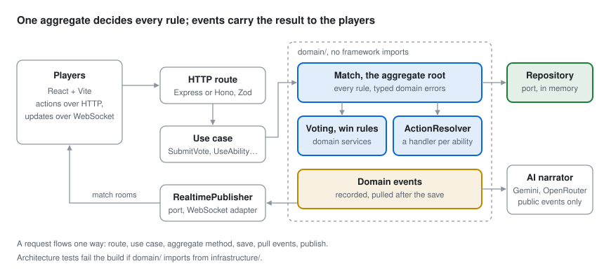

# Social Deduction Game

A real-time multiplayer game in the spirit of *Mafia* and *Werewolf*, built as a study in **Domain-Driven
Design and SOLID** in TypeScript. Players join a lobby, receive secret roles and go round by round through
**discussion → voting → action → resolution** until one side wins.

The gameplay is the excuse; the backend design is the point. Every rule lives in one aggregate, abilities
resolve in a fixed order through one handler each, and tests fail the build if the layers start to leak.

**[Play the live demo](https://social-deduction-game-tvek.onrender.com/)** ·
[Project board](https://github.com/users/MohamedAljoke/projects/2)



## Run it

You need Node.js 20.

```sh
git clone https://github.com/MohamedAljoke/social-deduction-game.git
cd social-deduction-game
npm run install:all
npm run dev            # the API on :3000 and the client on http://localhost:5173
```

Create a match at http://localhost:5173, then join it as the other players from private windows or other
browsers: each player's session is kept in the browser's storage, so two normal tabs would be the same
player.

```sh
npm run test --prefix backend -- --run   # domain, application, e2e and architecture tests
npm run test:e2e --prefix client         # full games in Playwright
```

The AI game master is optional. To try it, put `AI_PROVIDER=auto` and `GEMINI_API_KEY` and/or
`OPENROUTER_API_KEY` in `backend/.env`, then turn it on when creating a match.

## What's inside

- **A rich aggregate, not data bags.** `Match` owns players, phases, votes and actions, and every change
  goes through a method such as `submitVote` or `useAbility` that checks its own rules and throws a typed
  domain error when one is broken. → [docs/DOMAIN.md](docs/DOMAIN.md)
- **Domain events, published after the save.** The aggregate records what happened; the use case saves,
  then pulls the events and hands them to a `RealtimePublisher` port, so the domain never knows about
  WebSockets. → [docs/DOMAIN.md](docs/DOMAIN.md)
- **Abilities that resolve the same way every time.** Kill, protect, roleblock, investigate and vote
  shield run in fixed stages and by priority. Each is one `EffectHandler` class, so a new ability is a new
  class, not another `if`. → [docs/ABILITIES.md](docs/ABILITIES.md)
- **One room per match over WebSockets.** Actions go over HTTP and updates come back to the match's room;
  joins are authorized, investigation results go only to the investigator, and a refresh lands back in
  the game. → [docs/REALTIME.md](docs/REALTIME.md)
- **An optional AI game master that can't break the game.** It narrates from public events only, behind
  an `AiNarrator` port, with failover between Gemini and OpenRouter and a plain fallback message.
  → [docs/AI-NARRATOR.md](docs/AI-NARRATOR.md)
- **Architecture enforced by tests.** Fitness tests fail the build if `domain/` imports from
  `infrastructure/`. Unit and end-to-end tests in Vitest and multi-browser Playwright games run in CI.
  → [docs/TESTING.md](docs/TESTING.md)

## The code

| Path | What it is |
| --- | --- |
| `backend/src/domain` | Entities, the `Match` aggregate, domain services, ability handlers, events, errors and ports; no framework imports |
| `backend/src/application` | One use case per action: `CreateMatch`, `JoinMatch`, `SubmitVote`, `UseAbility`, `AdvancePhase`… |
| `backend/src/infrastructure` | Express and Hono adapters behind one `HttpServer` interface, WebSockets, in-memory repositories, AI providers |
| `client/` | React + Vite front end with a WebSocket gateway and English and Portuguese text |
| `shared/` | Ability definitions used by both the backend and the client |
| `docs/` | How it works; [docs/README.md](docs/README.md) also lists the design notes and ADRs |

**Stack:** TypeScript, Node.js, Express / Hono, WebSockets (`ws`), Zod, Vitest, React 19, Vite, Tailwind
CSS, Playwright, Gemini, OpenRouter.

## Author

**Mohamed Aljoke**, backend engineer · [Portfolio](https://mohamedaljoke.github.io/cv/) · [Blog](https://devmohami.hashnode.dev/)
